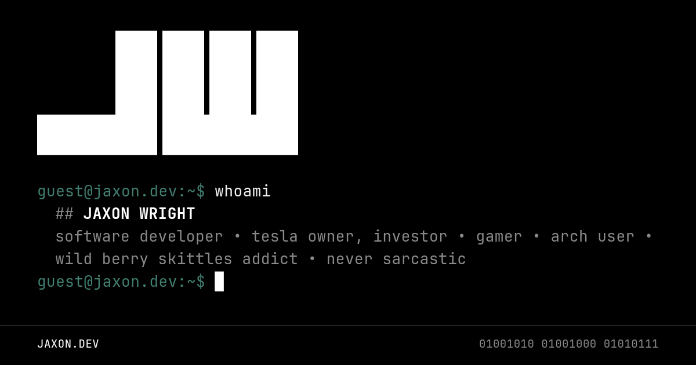

## About
This is the personal site of Jaxon Wright, a software developer in the Grand Rapids, Michigan area. It is built with Angular and looks and behaves like a terminal. Feel free to reference any of this for your own project or even fork the repository.

Every page is a command. Type one at the prompt or click one in the status bar:

| Command | Page |
| --- | --- |
| `about` | Who Jaxon is, with an ASCII portrait and work history |
| `projects` | Things he has built and open source contributions |
| `playlists` | His Spotify playlists |
| `contact` | Ways to reach him |
| `version` | Build and dependency info, fastfetch style |
| `theme <name>` | Switch to any [Omarchy](https://omarchy.org/) theme |
| `help` | Everything else |

Arrow keys walk the history and Tab completes. There are a few hidden commands too.

## Stack
- [Angular](https://github.com/angular/angular) with standalone components and signals. There is no UI library.
- [JetBrains Mono Nerd Font](https://github.com/ryanoasis/nerd-fonts), subset to drop the icon glyphs.
- Logos and the portrait are CP437 block art generated from images ahead of time.

## Development
Run `npm install`, then `npm start` to serve locally. `npm test` runs the unit tests and `npm run test:scripts` tests the Node scripts.

### Data
`npm run build` fetches two data files before building. `npm start` and `npm test` only create them if they are missing.
- `scripts/fetch-spotify-playlists.mjs` writes the playlists. It needs `SPOTIFY_CLIENT_ID` and `SPOTIFY_CLIENT_SECRET`, from the environment or a `.env` file.
- `scripts/fetch-contributions.mjs` writes the open source contributions from the GitHub API. `GITHUB_TOKEN` is optional and raises the rate limit. If the fetch fails, it falls back to a committed snapshot.

### Generated assets
These are committed, so rerun them only when their source changes.
- `python3 scripts/gen-ascii-art.py` regenerates the block art in `src/app/services/ascii-art.ts`. It needs Pillow, NumPy, and SciPy.
- `python3 scripts/subset-fonts.py` rebuilds the font files. It needs fonttools and brotli.
- `node scripts/gen-social-card.mjs` renders the Open Graph image (the one above) with headless Chromium. The X bio it prints is hardcoded in the script.
- `node scripts/gen-rmrf-paths.mjs` regenerates the output of a certain hidden command.

## Deploying
Cloudflare Pages deploys automatically when changes are pushed to `master`. GitHub Actions runs the tests and a production build on every push and pull request.

## License
This project uses the MIT license, which basically means you can do whatever you want with it. All that I ask is that you don't use it to deploy a portfolio website pretending to be me...
